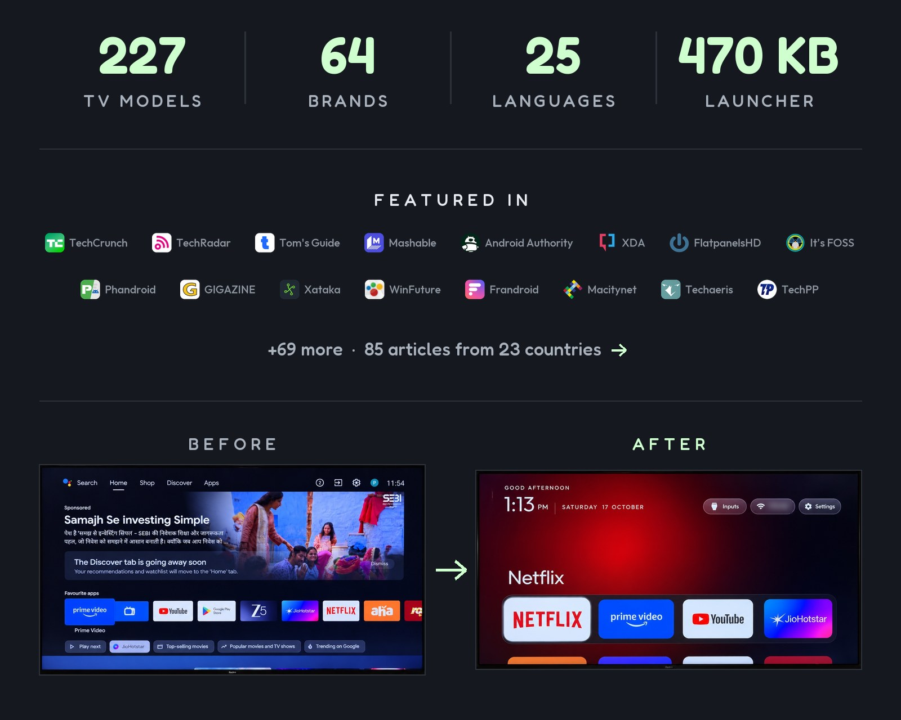
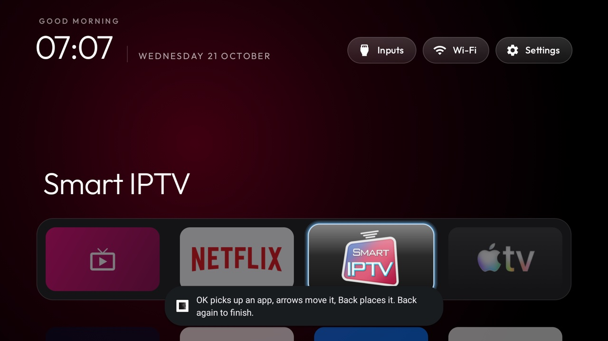

<p align="center">
  <a href="https://cleanyour.tv"></a>
</p>

<p align="center">
  <a href="https://github.com/Gathin23/cleanyourtv/stargazers"></a>
  <a href="https://github.com/Gathin23/cleanyourtv/pulls?q=is%3Amerged"></a>
  <a href="https://github.com/Gathin23/cleanyourtv/network/members"></a>
  <a href="https://github.com/Gathin23/cleanyourtv/graphs/contributors"></a>
  <a href="README.md"></a>
  <a href="https://buymeacoffee.com/gathint"></a>
  <a href="https://www.producthunt.com/products/cleanyourtv"></a>
</p>

<p align="center">
  <a href="https://trendshift.io/repositories/310225"></a>
</p>

<p align="center">
  <a href="docs/PRESS.md"></a>
</p>

> **Ghi chú về bản dịch:** Đây là bản dịch tiếng Việt không chính thức của README gốc
> [Gathin23/cleanyourtv](https://github.com/Gathin23/cleanyourtv). Nội dung và dự án thuộc về tác giả Gathin,
> phát hành theo giấy phép MIT. Khi có khác biệt, [README tiếng Anh](README.en.md)
> là bản chuẩn. Toàn bộ mã nguồn, công cụ, theme và danh sách TV của dự án được giữ nguyên trong repo này.

**Dòng tweet lan truyền:** [x.com/gathint/status/2111379569030939102](https://x.com/gathint/status/2111379569030939102)

Ngày 17 tháng 10 năm 2026, tôi đăng ảnh trước và sau chiếc TV của bố mẹ, được Claude Code dọn dẹp qua Wi-Fi.
Bài đạt 7,4 triệu lượt xem, mọi người bắt đầu làm điều tương tự với TV nhà mình, và các phản hồi biến thành
những danh sách ở đây: hơn 170 mẫu TV từ hơn 200 người đóng góp trong bốn ngày. Repo từng tên là tv-vibehack
đến ngày 19; các liên kết cũ vẫn dùng được.

**Giao diện, công tắc và tiện ích mở rộng:** [cleanyour.tv/addons](https://cleanyour.tv/addons)

## Cách hoạt động

TV Android có cùng cầu gỡ lỗi (debug bridge) như điện thoại Android. Bật gỡ lỗi USB trong tuỳ chọn nhà phát triển
của TV, cho phép máy tính của bạn một lần, phần còn lại là bộ công cụ Android tiêu chuẩn:

| Bước | Chuyện gì xảy ra |
|---|---|
| **Sao&nbsp;lưu** | Danh sách các gói đã cài và các cài đặt. |
| **Tắt** | Dịch vụ thu thập dữ liệu, dịch vụ quảng cáo, các hàng nội dung và ứng dụng rác cài sẵn của hãng, bằng `pm disable-user`. Không gỡ cài đặt gì, nên script khôi phục có thể hoàn tác từng bước. |
| **Cài đặt** | Một launcher gốc nhỏ gọn, được đặt làm màn hình chính mặc định. |

**Không root, không cần cáp, không gỡ cài đặt gì, và khôi phục chỉ bằng một dòng lệnh nếu bạn đổi ý.**

Bloatware khác nhau theo từng hãng, nên câu lệnh sẽ để trợ lý lập trình của bạn tự phát hiện trên TV và hỏi
trước khi động vào bất cứ thứ gì bạn có thể đang dùng.

## Bắt đầu nhanh

Bạn cần một máy tính cùng mạng Wi-Fi với TV và một trợ lý lập trình có quyền truy cập shell.

Bất kỳ công cụ nào sau đây đều được: Claude Code (trên [0G Private Computer](https://pc.0g.ai) hoặc
[gói Anthropic](https://claude.com/pricing)), [Codex](https://github.com/openai/codex) hoặc
[Gemini CLI](https://github.com/google-gemini/gemini-cli).

| Ở đâu | Làm gì |
|---|---|
| **1. Trên TV** | Cài đặt → Tuỳ chọn thiết bị → Giới thiệu → nhấn OK vào **Build** bảy lần → quay lại → Tuỳ chọn nhà phát triển → bật **Gỡ lỗi USB**. Nếu thấy công tắc Gỡ lỗi mạng hoặc ADB, hãy bật luôn. Giữ TV bật. |
| **2. Trên máy tính** | Dán [`PROMPT.md`](PROMPT.md) vào trợ lý và điền mẫu TV của bạn. |
| **3. Làm theo** | Chấp nhận "Cho phép gỡ lỗi USB?" trên TV, rồi trả lời bản danh sách kiểm tra: bạn dùng ứng dụng nào, kích thước dock và thứ tự ứng dụng, có giữ trợ lý giọng nói, Chromecast và cập nhật hay không. |

Trợ lý sẽ sao lưu, tinh gọn (debloat), build và cài launcher, đồng thời kiểm tra từng bước bằng ảnh chụp
màn hình lấy từ TV. Với repo này làm ngữ cảnh, việc này mất khoảng mười lăm phút.

## Bạn nhận được gì

Một màn hình chính trông như Apple TV và biết tránh đường:

| Thành phần | Trông như thế nào |
|---|---|
| **Màn hình chính đen tuyền** | Một dock gồm bốn ứng dụng bạn thích nhất trong dải bo tròn, đúng vị trí Apple TV đặt nó. |
| **Kệ trên (top shelf)** | Ghi tên ứng dụng đang chọn bằng chữ lớn, kèm quầng sáng nền lấy màu từ ảnh bìa của ứng dụng. |
| **Phần còn lại của ứng dụng dạng lưới** | Trượt lên khi bạn nhấn Xuống. |
| **Một điểm nhấn kính nổi** | Nảy từ ô này sang ô khác. Ô đang chọn được nâng lên và hiện tên. |
| **Ba nút kính mờ** | Đầu vào (cổng HDMI theo tên bạn đặt trong cài đặt TV, AV, Live TV), Wi-Fi hoặc Ethernet kèm tên mạng, Cài đặt. |
| **Lời chào, đồng hồ mảnh và ngày** | Dùng font [Outfit](https://fonts.google.com/specimen/Outfit), kèm trình bảo vệ màn hình đồng hồ đồng bộ. Bật `show_stats` trong config hoặc theme để có một dòng dưới đồng hồ: CPU, bộ nhớ trống và dung lượng trống. Mặc định tắt, và chỉ làm mới khi màn hình Home đang hiển thị. |
| **Theme và thẻ module** | Theme đổi màu, hình nền, dock và số cột mà không cần build lại; thẻ module cho phép ứng dụng khác cắm một ô vào, chỉ khi bạn đồng ý. |

Và một chiếc TV thôi chống lại bạn: không hàng được tài trợ, không "Discover" làm phiền, không analytics gọi về
nhà, không ứng dụng bạn chưa từng yêu cầu.

| | |
|---|---|
|  |  |
| *Kệ trên và quầng sáng nền* | *Đầu vào: HDMI kèm trạng thái kết nối, AV, Live TV* |
|  |  |
| *Lưới ứng dụng, một điểm nhấn kính, tên của ô* | *Trình bảo vệ màn hình đồng hồ, trôi để không bị lưu ảnh* |
|  |  |
| *Theme Aurora, đẩy vào bằng `tools/theme.sh`* | *Sáu cột và dock sáu ứng dụng, vẫn cùng launcher* |
|  |  |
| *Với `tile_menu`, giữ OK trên một ô, chọn Move: các phím mũi tên mang ô đi, Back đặt nó xuống* | *Thư viện ứng dụng: một lần nhấn đưa ứng dụng đã gỡ trở lại Home* |

## TV được hỗ trợ

Bất cứ thứ gì chạy **Android TV** hoặc **Google TV**.

| Nền tảng | Phần hoạt động |
|---|---|
| **Android TV, Google TV** | Cả phần tinh gọn lẫn launcher. |
| **Fire TV** | Chỉ phần tinh gọn, vì Fire OS không giao Home cho launcher bên thứ ba. Và trên Fire TV Box 2015 (Fire OS 5) thì ngay cả phần đó cũng thất bại: mọi đường `pm` đều bị từ chối. |
| **Một vài mẫu TCL thị trường Trung Quốc** | Chúng từ chối cài bất kỳ launcher nào; danh sách của chúng ghi rõ điều này ở phần đầu. |
| **Samsung (Tizen), LG (webOS)** | Hệ điều hành khác. Xem [SHOWCASE.md](SHOWCASE.md#other-platforms-fire-tv-and-lg-webos) để biết ba bản port webOS, và [docs/devices/samsung-tizen.md](docs/devices/samsung-tizen.md) để biết một TV Samsung 2021 trả lời gì qua Wi-Fi (không có ADB, nên không có `pm disable-user`) nếu bạn đang cân nhắc port lên Tizen. |

Danh sách đã kiểm chứng từ người đóng góp, mỗi mẫu một thư mục trong [`examples/`](examples):

**TCL** 55 · **Xiaomi** 27 · **Sony** 26 · **Philips** 12 · **Hisense** 9 · **Skyworth** 9 · **Amazon Fire TV** 7 ·
**Thomson** 4 · **BenQ** 3 · **Google** 3 · **Panasonic** 3 · **CHiQ** 2 · **FFalcon** 2 · **Haier** 2 · **Hitachi** 2 ·
**Kalley** 2 · **Nokia** 2 · **NVIDIA Shield** 2 · **OnePlus** 2 · **onn** 2 · **Redmi** 2 · **Toshiba** 2 · **Vu** 2 ·
AiPro2K · AIWA · Artel · Caxium · Cecotec · Challenger · Compac · Dialog · EKO · Freebox · Insignia Fire TV · JVC ·
Karbonn · Kogan · Motorola · MTC · Noblex · OK. · PEAQ · Polytron · PRISM+ · RCA · Sankey · SANYO · SHARP ·
Super General · Tele System · Tornado · Turkcell · Verizon · Vidda · Vision ·
máy chiếu Anker Nebula, BYINTEK, Epson, Gadnic, JMGO, Portronics, Stellamore, Wanbo và XGIMI

<details>
<summary><strong>Danh sách đầy đủ</strong></summary>

| TV | Hệ điều hành |
|---|---|
| AiPro2K (Expressluck, dongnae; họ Changhong AI PONT) | Android TV 14 |
| AIWA AI PONT SA (Changhong, osaka, ISDB86AW) | Google TV 14 |
| Amazon Fire TV, AFTDEC012E (ginza), Android 11 | Fire OS / Android 11 |
| Amazon Fire TV smart TV (AFTEU014, greta, MediaTek m7322), Đức | Fire OS 7.6.8.5 / Android 9 |
| Amazon Fire TV 50" 4K smart TV (AFTTIFF43, brandenburg) | Fire OS 7.7.1.7 / Android 9 |
| Amazon Fire TV Stick 4K Max, gen 1 2021 (AFTKA, kara), Colombia | Fire OS 7.7.1.3 / Android 9 |
| Amazon Fire TV Stick 4K, gen 1 2018 (AFTMM, mantis) | Fire OS 6.7.1.1 / Android 7.1 |
| Amazon Fire TV Stick 4K, gen 2 2023 (AFTKM, karat), Brazil | Fire OS 8.1.8.5 / Android 11 |
| Amazon Fire TV Stick Lite, gen 1 2020 (AFTSS, sheldon) | Fire OS 7.7.1.7 / Android 9 |
| Máy chiếu Anker Nebula Cosmos D2140 (D2140-Cosmos, SDMC/Amlogic, 2 GB), Việt Nam | Android TV 9 |
| Máy chiếu Anker Nebula D2426 (D2426_CapsuleIIIPro, baekdu, SDMC/MediaTek m7632, 1,7 GB), Brazil | Android TV 14 |
| Artel smart TV (CVTE TP.MT5510S.PB782, cvt_mt5863_eu, SMART_TV), Uzbekistan | Android 7.0 |
| BenQ E55-735 (Changhong AI PONT, DVB96BQ) | Google TV 14 |
| BenQ E55-750 (Changhong AI PONT, DVB96BQ) | Google TV (Android 11) |
| Máy chiếu di động BenQ GV32 (SDMC, BenQ_GV01, himalaya, MediaTek m7332) | Google TV 14 |
| Máy chiếu BYINTEK Love U4, 1080P (Skyworth RG_HS352, HiSilicon Hi3751V350, 1 GB), Brazil | Android 9 |
| Máy chiếu BYINTEK T5 Max (stick Google TV tích hợp: SkyworthDigital YYT, Amlogic), Brazil | Google TV 14 |
| Caxium 58" 147 cm UHD Smart TV (Realtek RTD285O, RTK2851P, TopTech + Zeasn), Colombia | Android TV 9 |
| Cecotec VQU10065S 65" QLED (Vestel, shandao, MediaTek), Tây Ban Nha | Android TV 14 |
| Challenger 32T22 BT (cvt_mt5863_col, board TP.MT5510.PB781, MediaTek MT5659, 1 GB RAM), Colombia | Android 7.0 |
| CHiQ AI PONT (Changhong GTVU65, dangni, MediaTek mt5867) | Google TV 14 |
| CHiQ AI PONT (DVB93CQ) | Android TV 11 |
| Chromecast with Google TV 4K (sabrina) | Google TV 14 |
| Chromecast with Google TV HD (boreal) | Google TV 14 |
| Compac ATV R2 (SCBC R2, Realtek RTD285O) | Android TV 9 |
| Dialog ViU (SEI Robotics SEI103DL, Amlogic, middleware NES), Sri Lanka | Android TV 9 |
| EKO 2K Google TV (MTC, tennoji, MediaTek mt5867 / T56) | Google TV 14 |
| Máy chiếu laser Epson LS800 (module Askey HA90, sti6202d101, Amlogic) | Android TV 14 |
| FFalcon (雷鸟) 鹤6 PRO 65S585C Pro (Trung Quốc, tcl_mt5879_cn, MediaTek MT9653) | Android TV 11 |
| FFalcon (雷鸟) r34a0, Trung Quốc (V8-A920T01-LF1V147, Amlogic T920), 1 GB | Android 5.1.1 |
| Freebox Player POP (Free, fbx8am, Amlogic), box IPTV/DVB-T | Android TV 10 |
| Máy chiếu Gadnic PROJ100W (stick Google TV tích hợp: SkyworthDigital YYT, Amlogic HP46B), Argentina | Google TV 14 |
| Google TV Streamer 4K (kirkwood, GZRNL) | Google TV 14 |
| Haier Android TV DVB2K (broadway, HaierATVT56DVB) | Android TV 11 |
| Haier H32S80EFX (MatrixTV CE, HRT56EU, deto, MediaTek), Thái Lan | Google TV 14 |
| Hisense E5Q Pro (VIDAA_TV, MediaTek MT9653), Trung Quốc | Android TV 11 |
| Hisense Fire TV (AFTCIBFBD1, coyote, MediaTek), Mỹ | Fire OS 8.0 / Android 11 |
| Hisense HG9 (HiSmart 4K A4FFM) | Android TV 9 |
| Hisense HiSmartTV A4 (xiaoyushan, MStar m7322), firmware Android 11 RTT2.221108.001 | Android TV 11 |
| Hisense HiSmartTV A4 (xiaoyushan, MStar m7322), Ấn Độ | Android TV 9 |
| Hisense SmartTV 4K FFM (songshan, MediaTek m7632) | Android 11 (SDK 30) |
| Hisense SmartTV 4K FFM (huangshan, MediaTek), Mỹ Latinh; cả Hisense U9DG của Mỹ | Android TV 10 |
| Hisense SmartTV 4K FFM (lushan, MediaTek MT9676), Mông Cổ | Google TV 12 |
| Hisense U75 (hengshan, MediaTek), Mỹ Latinh | Google TV 12 |
| Hitachi 65QLEDSM20 (MTC, bangbae, MediaTek m7322), Úc | Android TV 11 |
| Hitachi CDH-LE32SMART21 (TCL C06, C06_2K_GB, MediaTek MT9221, 1 GB), Argentina | Android TV 11 |
| Insignia 55" F30 4K Fire TV (NS-55F301NA25, AFTDCT31, duckie) | Fire OS 7 / Android 9 |
| Máy chiếu JMGO N1S (K80A, holan, MediaTek m7332), Úc | Google TV 14 |
| JVC Android TV (Vestel, BARTU_Jvc, menlo, MediaTek mt5867), Tây Ban Nha | Android TV 11 |
| Kalley 43G200 (thiết bị R3_GTV, MOKA, Realtek RTD2841A), Mỹ Latinh | Google TV 14 |
| Kalley R10G (thiết bị R10G, sản phẩm ACER_FFM, MOKA, Realtek RTD2875P), Mỹ Latinh | Google TV 14 |
| Karbonn SWTV-20AE (OEM Skyworth, SW4H, MediaTek), Ấn Độ | Android TV 10 |
| Kogan Google TV (Changhong CHiQ AI PONT, GTVU65KG, dangni, MediaTek mt5867), Úc | Google TV 14 |
| Motorola SWTV-24AE-FHD (OEM Skyworth, beomil, MediaTek), Ấn Độ/Toàn cầu | Google TV 14 |
| MTC UK 2K Android TV (tabata, MediaTek m5621; firmware họ JVC, có `android.autoinstalls.config.JVC`), Anh | Android TV 11 |
| Noblex NoblexTV (Skyworth, shinjuku, MediaTek m5621), Argentina | Android TV 11 |
| Nokia Streaming Box 8000 (Sagemcom/NES, SEI600NK4, HND, Amlogic) | Android TV 14 |
| Nokia Streaming Box 8010 (Sagemcom/NES, SEI804NK, YYJ, Amlogic) | Android TV 14 |
| NVIDIA SHIELD TV 2019 bản ống (P3430, sif) | Android TV 11 |
| NVIDIA SHIELD TV Pro 2019 (P2897, mdarcy) | Android TV 11 |
| OK. AI PONT (Changhong, ikebukuro, MediaTek), Ý | Android TV 11 |
| OnePlus TV (D00, Dubai) | Google TV 14 |
| OnePlus Y1 43" (Y Series, shibuya) | Android TV 11 |
| onn 4K Streaming Box (2023, Walmart; YOC, Amlogic), Mỹ | Google TV 14 |
| onn. 4K Plus Streaming (2025, Walmart; coffey, Amlogic S905X5M), Mỹ | Google TV 14 |
| Panasonic 4KTV-0SU (Skyworth SW4H, MediaTek m7332), khu vực Vịnh | Android TV 10 |
| Panasonic 4KTV-JUP (Jupiter_PA, MediaTek) | Android TV 11 |
| Panasonic TH-40HS550K (Skyworth, GS655 shibuya, MediaTek) | Android TV 11 |
| Philips 50PUD7406/43 (TPV, PH0M_EA_T32, MStar/MediaTek), Chile | Android TV 11 |
| PEAQ PTV 43AQU-5023C (Changhong, báo là OK. AI PONT, dundas, MediaTek m7332) | Android TV 11 |
| Philips 50PUS8517/12 (TP Vision, PH1M_EA_9970A, MediaTek MT5895), Châu Âu | Android TV 11 |
| Philips 55OLED707/12 (TP Vision, PH1M_EA_9970A, MediaTek MT5895), Anh | Android TV 11 |
| Philips 55OLED708/12 (TPV, PH1M_WW_9972, MediaTek), Ba Lan | Google TV 12 |
| Philips 55PUS7503/12 (TP Vision TPM171E, PH7M_EU_5596, MediaTek MT5891), Châu Âu | Android TV 8.0 |
| Philips 65PUS8102/12 (TP Vision TPM171E, PH7M_EU_5596, MediaTek MT5891), Châu Âu | Android TV 8.0 |
| Philips 65PUS9435/12 (TP Vision TPM191E, PH9M_EA_5599, MediaTek MT5887), Đức | Android TV 12 |
| Philips 75PUS8505/12 (TP Vision TPM191E, PH9M_EA_5599, MediaTek MT5887), Châu Âu | Android TV 12 |
| Philips Google TV TA7 (TPV, PH3M_AL_T32, MediaTek), Brazil | Google TV 14 |
| Philips R8G Google TV (MOKA, whitefield, Realtek RTD2851F), Mỹ | Google TV 14 |
| Philips Smart 4K TV (Skyworth, eleonas, MediaTek), Ấn Độ | Google TV 14 |
| Philips TPM191E (TP Vision, PH9M_EA_5599, MediaTek mt5887), Châu Âu | Android TV 12 |
| Polytron 2K (WLTV POLYTRON2K, hayward; board Hisense/CVTE, MediaTek mt5867), Indonesia | Android TV 11 |
| Máy chiếu LED thông minh Portronics Beem 470 (Allwinner H713, 1 GB), Ấn Độ | Android 11 |
| PRISM+ Q65 Ultra 2026 QLED 4K AI Google TV (R10G, PRISMPLUS_FFM, MOKA, SoC Realtek RTD2875, nền tảng RTD6748) | Google TV 14 |
| RCA AI PONT SA (Changhong, redwood, ISDB92RC; cũng bán dưới tên realme 40 inch) | Android 14 |
| Redmi TV (MiTV-ANTL0, starwars) | Android 5.1.1 (không phải Android TV) |
| Redmi TV (MiTV-MFTP0, alita), firmware Trung Quốc 23.2.10.6129 | Android TV 9 (bản CN) |
| SANYO ATV R2 (SCBC, Realtek RTD285O) | Android TV 9 |
| Sankey SMART2KTVSE (Whale OS, SiliconPlayer am30bm) | Android TV 13 |
| SHARP AQUOS TVE21F (AQUOS-TVE21F, banqiao, CVTE/MediaTek), Anh | Android TV 14 |
| Skyworth / Coocaa 8R40_K5C (Realtek rtd285x, 1 GB, 32-bit), firmware nội địa Trung Quốc | Android 8.0 (không phải Google TV) |
| Skyworth 65A3F (7T641_A3F, MediaTek MT9633), Trung Quốc | Android 13 (CCOS 10.01.250328) |
| Skyworth Coocaa K3 Pro 90P3D Max (8R145_P3DM, Realtek RTD2885N), thị trường Trung Quốc | Android 11 (Coocaa OS) |
| Skyworth 7S60_A5 (sky8S34, 1,9 GB), thị trường Trung Quốc | Coocaa OS / Android 8 |
| Skyworth SW-22SA (SW6H, MediaTek), ~1,9 GB | Android TV 14 (home Google TV) |
| Skyworth SWTV-21AE (sunnyvale, MediaTek) | Android TV 14 |
| Skyworth SWTV-22AE-FHD (umeda, MediaTek), Việt Nam/Toàn cầu | Google TV 14 |
| Skyworth SWTV-24AE-4K NF (eleonas, MediaTek mt5896), Nam Phi/Toàn cầu | Google TV 14 |
| Skyworth SWTV-24NA-4K NF (eleonas, MediaTek mt5896), Mỹ | Google TV 14 |
| Sony BRAVIA 4K AE2 (BRAVIA_AE2, MediaTek MT5897), Bắc Mỹ | Google TV 14 |
| Sony BRAVIA 4K GB (BRAVIA_ATV2_EU, BRAVIA_ATV2) | Android TV 9 |
| Sony BRAVIA 4K GB (BRAVIA_ATV2_UC, MediaTek mt5891) | Android TV 9 |
| Sony BRAVIA 4K UR2 (BRAVIA_UR2_4K, MediaTek) | Android TV 10 |
| Sony BRAVIA 4K VH2 (KD-55X80J, BRAVIA_VH2, MediaTek), EU | Google TV 12 |
| Sony BRAVIA 4K VH21 (KD-65X85K, 2022, BRAVIA_VH21, MediaTek MT5895), Úc | Google TV 12 |
| Sony BRAVIA 4K VH21 (XR-55A80K, 2022, BRAVIA_VH21, MediaTek mt5895), EU | Google TV 12 |
| Sony BRAVIA 9 II (K-65XR90M2, BRAVIA_AE3, MediaTek MT5838) | Google TV 14 |
| Sony BRAVIA BF1 (dòng BRAVIA 2 II, BRAVIA_BF1_4K_A, MediaTek) | Google TV 12 |
| Sony BRAVIA KD-49X8307C (2015, "BRAVIA 4K 2015", SVP-DTV15, MediaTek), firmware EU | Android TV 7.0 |
| Sony BRAVIA KD-55X8509C (2015, "BRAVIA 4K 2015", SVP-DTV15, MediaTek), firmware EU | Android TV 7.0 |
| Sony BRAVIA KD-55X85J (2021, BRAVIA_VH2, MediaTek MT5895), Nam Mỹ | Google TV 12 |
| Sony BRAVIA KD-55XE8596 (2017, "BRAVIA 4K GB", BRAVIA_ATV2_EU, MediaTek MT5891), Anh | Android TV 9 |
| Sony BRAVIA KD-65X80J (2021, BRAVIA_VH2, MediaTek), Ấn Độ | Google TV 10 |
| Sony BRAVIA KD-43X80L (2023, BRAVIA_VH22, MediaTek MT5895), EU | Google TV 12 |
| Sony BRAVIA KD-65X82L (2023, BRAVIA_VH22, MediaTek), Ấn Độ | Google TV 12 |
| Sony BRAVIA KD-65X9300D (2016, SVP-DTV15, MediaTek), Châu Á - Thái Bình Dương | Android TV 8.0 |
| Sony BRAVIA TL2 (OD0M_EA_T32, TPV, MediaTek), Châu Âu | Android TV 11 |
| Sony BRAVIA VU31 4K (BRAVIA_VU31_4K, Realtek), Ấn Độ | Google TV 14 |
| Sony BRAVIA X9000H (2020, BRAVIA_VH1_CN, MediaTek MT5895), Trung Quốc | Android TV 12 |
| Sony BRAVIA XBR-55X850D (model Android "BRAVIA 4K 2015"), firmware 6.827 | Android TV 8.0.0 |
| Sony BRAVIA XBR-55X850C (2015, "BRAVIA 4K 2015", SVP-DTV15, MediaTek), firmware Mỹ | Android TV 8.0 |
| Sony BRAVIA XBR-65X900E (2017, BRAVIA_ATV2) | Android TV 9 |
| Sony BRAVIA XBR-65X900F (2018, BRAVIA_ATV3_4K, MediaTek MT5891), Mỹ/Canada | Android TV 9 |
| Sony XR-65A80J (OLED 65 inch, 2021, BRAVIA_VH2), EU | Google TV 12 |
| Sony XR-65X90J (2021, BRAVIA_VH2, MediaTek MT5895), Trung Quốc | Android TV 10 |
| Máy chiếu Stellamore T950S (Droidlogic be30a3, Amlogic txhd2) | Android 13 |
| Super General 55" 4K (CVTE TP.SK708D.PC821, Amlogic T972, x30a4, 1 GB), Ả Rập Xê Út | Android 9 |
| TCL / FFalcon Trung Quốc (tcl9655_cn, MediaTek MT9655 "merak", UTT2.250416.001 AU01) | Android 14 |
| TCL 32L5A (C06, model "Smart TV", 1 GB) | Android TV 11 |
| TCL 32S5400A (C06, C06_2K_GB, MediaTek MT9221, 1 GB), 2023 | Android TV 11 |
| TCL 32S5K (C06, C06_2K_GB, MediaTek MT9221, 918 MB), EU | Android TV 11 |
| TCL 40S5400A (C06, C06_2K_GB, MediaTek MT9221, 1 GB) | Android TV 11 |
| TCL 43P615 (Châu Âu, BeyondTV, Realtek RTD2851, AR06) | Android TV 11 |
| TCL 43S450F-CA (S4 Fire TV Edition, AFTDEC012E, ginza, MediaTek), Canada | Fire OS 8.1.8.5 / Android 11 |
| TCL 43S5400A (C06, C06_2K_GB, MediaTek MT9221, 1 GB) | Android TV 11 |
| TCL 43C645 (Smart TV Pro, Realtek RTD2851 / R51MT05, V8-R51MT05-LF1V652); cả TCL 60C635 (G03_4K_GB, Realtek rtd288o), Tây Ban Nha | Launcher Google TV trên Android TV 11 |
| TCL 43EP660 (Châu Âu, BeyondTV, Realtek rtd285o, V8-R851T02-LF1V378) | Android TV 9 |
| TCL 43S5K (G13, G13_2K_GB, MediaTek MT9221, 1 GB), Ấn Độ | Google TV 14 |
| TCL 50C725K (Smart TV Pro, BeyondTV4/BeyondTV6, RTD2851M, Realtek rtd288o, 2 GB), bản AR10 | Android TV 11 |
| TCL 50P735 (BeyondTV4, Smart TV Pro) | Google TV 11 |
| TCL 50DP660 (Châu Âu, "Percee TV", MediaTek MT5658 / board mt5891, V8-T658T01-LF1V602) | Android TV 8.0 |
| TCL 50EP680 (Châu Âu, BeyondTV, Realtek rtd285o) | Android TV 11 |
| TCL 50P615 (Hy Lạp, BeyondTV, Realtek RTD2851 / rtd285o, AR05) | Android TV 11 |
| TCL 55" 4K Google TV, 2023 (G10, G10_4K_US_NF); cả TCL 55P6K, Tây Ban Nha (G10_4K_GB_NF_32BIT) | Google TV 12 |
| TCL 55C715 QLED (Châu Âu, BeyondTV2, Realtek RTD2851, V8-R851T02-LF1V606) | Android TV 9 |
| TCL 55C725 (Smart TV Pro, BeyondTV4, G03_4K_GB, Realtek R51MT05, V8-R51MT05-LF1V620), Ý | Launcher Google TV trên Android TV 11 |
| TCL 55C745, 2023 (G08, G08_4K_GB, MediaTek tcl9618) | Google TV 14 |
| TCL 55C815 (2020, Châu Âu/Đan Mạch, BeyondTV2, Realtek rtd285o) | Android TV 11 |
| TCL 55EP640 (Hy Lạp, BeyondTV, Realtek RTD2851 / rtd285o, AR04) | Android TV 11 |
| TCL 55P638 (Smart TV, BeyondTV4) | Android TV 11 |
| TCL 55P7K, Trung Đông (G10, G10_4K_GB, Realtek RTD2875P) | Google TV 12 |
| TCL 55P8LS QD-Mini LED, Việt Nam (G10, G10_4K_GB_32BIT, Realtek rtd6748) | Google TV 12 |
| TCL 55Q10G Pro (Trung Quốc, tcl_mt5879_cn, MediaTek MT9952) | Android TV 11 |
| TCL 55S470G (G10, G10_4K_US_NF, Realtek), Mỹ | Google TV 12 |
| TCL 58S571F (TCL Fire TV, AFTDEC012E, ginza, MediaTek mt5896), Mỹ | Fire OS 8 / Android 11 |
| TCL 65C725 (Smart TV Pro, BeyondTV4) | Android TV 11 |
| TCL 65C735 (Smart TV Pro, G05, MediaTek), Pháp; cả TCL 55C728, Thổ Nhĩ Kỳ | Google TV 11 |
| TCL 65C7K (Smart TV Pro, G08, G08_4K_GB, MediaTek mt5896), Brazil | Google TV 14 |
| TCL 65Q550G (TCL Smart TV, Google TV 11, V8-R51MT08-LF1V095.021344) | Google TV |
| TCL 65Q650G (Q6 Mỹ 2023, BeyondTV4, Realtek RTD2851 / R51MT08, V8-R51MT08-LF1V095, 2 GB) | Google TV 11 |
| TCL 85RM7L (G08, G08_4K_GB, MediaTek tcl9618) | Google TV 14 |
| TCL 75T7 (Smart TV Pro, G08, G08_4K_US, MediaTek tcl9618), firmware Mỹ | Google TV 14 |
| TCL Q7C (Smart TV Pro, G08, G08_4K_GB, MediaTek tcl9618), firmware Châu Âu | Google TV 14 |
| TCL ak30a5 (Trung Quốc, Amlogic) | Android TV 9 |
| TCL BeyondTV (Ấn Độ) | Android TV 9 |
| TCL BeyondTV, Ba Lan (Realtek RTD2851, AP03, 2 GB) | Android TV 9 |
| TCL BeyondTV, EU/Bắc Âu (Realtek RTD2851, V8-R851T02-LF1V606) | Android TV 9 |
| TCL BeyondTV2 (Mỹ Latinh / Brazil, Realtek RTD2851) | Android TV 9 |
| TCL BeyondTV2, bản Android 11 (AR05, Realtek rtd285o) | Android TV 11 |
| TCL C755 QD-Mini LED, 2024, Úc (G08, MediaTek tcl9618) | Google TV 14 |
| TCL 55C7K QD-Mini LED, 2025, Anh (G08, MediaTek tcl9618) | Google TV 14 |
| TCL C89B 85", 2024, biến thể địa phương của C855 (G08, G08_4K_GB, MediaTek tcl9618) | Google TV 14 |
| TCL 75C845X2, Anh/Châu Âu (G08_4K_GB, MediaTek tcl9618) | Google TV 14 |
| TCL L40S66E (C06, C06_2K_GB, MediaTek MT9221, 1 GB), Argentina | Android TV 11 |
| TCL QM6K Pro, 2025 (G08, MediaTek tcl9618) | Google TV 14 |
| TCL Smart TV (G07, G07_4K_GB_NF, Realtek RTD2851A, 2 GB) | Google TV 11 |
| TCL Smart TV Pro (G03, G03_4K_GB, BeyondTV4, Realtek R51MT05, V8-R51MT05-LF1V620), firmware Trung Đông | Google TV 11 |
| TCL Smart TV Pro (G05, G05_4K_US, MediaTek MT5889) | Google TV 11 |
| TCL Smart TV Pro (G08, G08_4K_GB, MediaTek), firmware Úc | Google TV 12 |
| TCL Smart TV Pro (G08, G08_4K_GB, MediaTek), firmware Châu Âu/Anh | Android TV 12 |
| TCL Smart TV Pro (G09, G09_4K_GB, Amlogic T5M, 2 GB), firmware Anh, Brazil | Google TV 12 |
| TCL UnionTV, Mỹ Latinh (TCL như Thomson 32HE5800, Realtek RT2841) | Android TV 9 |
| Tele System TS ON T2/HD (ONT2HD, SDMC, Amlogic), Ý | Android TV 11 |
| Thomson 32HE5800 (UnionTV do TCL làm, Realtek RT2841), Tây Ban Nha | Android TV 9 |
| Thomson 43RT1055 FA Series (SPPL, sauve, Realtek RTD2841A), Ấn Độ | Android TV 14 |
| Thomson SPPL 4K Google TV (Skyworth SW6H, MediaTek, cùng board với `skyworth-sw-22sa/`), Ấn Độ, ~1,9 GB | Android TV 14 (home Google TV) |
| Thomson T32RTL6000 (SCBC, Realtek; Android báo model `ATV R1`) | Android TV 9 |
| Tornado 65UA1400E (El Araby, Skyworth SW4H, MediaTek m7332), Ai Cập | Android TV 11 |
| Toshiba (Vestel Cosmos170, yeoksam, MediaTek), Tây Ban Nha | Android TV 11 |
| Toshiba Fire TV (AFTHA004, hazel) | Fire OS 7 / Android 9 |
| Turkcell TV+ 4K Box (SDMC DV6069Y, Amlogic), Thổ Nhĩ Kỳ, box streaming của nhà mạng | Android TV 10 |
| Verizon Stream TV, gen 1 (WNC JS8V, Amlogic), Mỹ | Android 12 |
| Vidda VIDAA_TV (thương hiệu con của Hisense; thiết bị MT9653, board mt5879), JuUI Trung Quốc | Android TV 11 |
| Vision 2024VISION43STV (CVTE TP.T950D4T.PB751, Amlogic T950D4, 1 GB), Châu Âu | Android 13 |
| Vu 4K (HVCL, lushan, MediaTek), Ấn Độ | Google TV 12 |
| Vu Premium FHD 43 inch (Smart 2K ATV4, hamamatsucho), Ấn Độ | Android TV 9 |
| Máy chiếu Wanbo X5 Pro (stick Google TV tích hợp: SkyworthDigital YYT, Amlogic), Úc | Google TV 14 |
| Máy chiếu XGIMI Horizon S Pro (XK03H, xgimigalileo, MediaTek) | Android TV 11 |
| Máy chiếu XGIMI MoGo 2 (MoGo, xgimiapollo, pokemon) | Android TV 11 |
| Máy chiếu XGIMI MoGo 3 Pro (G0035, altai, MediaTek) | Google TV 14 |
| Xiaomi Mi Box S (MIBOX4, oneday), box streaming | Android TV 9 |
| Xiaomi Mi Box S gen 2 (MiTV-AFKR0, jaws), box streaming | Google TV 11 |
| Xiaomi Mi TV (MiTV-MOOQ0, croods) | Android TV 10 |
| Xiaomi Mi TV 4A (MiTV-MOOQ1) | Android TV 10 |
| Xiaomi MiTV-AESP0 stick (aquaman, 1 GB) | Android TV 9 |
| Xiaomi MiTV-ANSP0 (小米电视5 Pro 65", jobs, Amlogic), firmware Trung Quốc 23.6.5.3226, 4 GB RAM | Android TV 9 (bản CN) |
| Xiaomi MiTV-ASTP0 (mulan, bán dưới tên L55M7-EA), firmware Trung Quốc 22.12.2.1630, 1,5 GB RAM | Android TV 9 (bản CN) |
| Xiaomi MiTV-ASTP1 (maverick), firmware Trung Quốc 2.40.641.0514.cn, 1 GB RAM, 720p | Android TV 9 (bản CN) |
| Xiaomi MiTV-MSSP2 (volver, MediaTek), firmware PI.4621, RAM thấp | Android TV 9 |
| Xiaomi TV EA Pro 55" (MiTV-MTEQ0, baymax, MediaTek), firmware Trung Quốc 23.6.26.4028 | Android TV 10 (bản CN) |
| Xiaomi MiTV-AXFR1 (rango, Amlogic, 1 GB), Ấn Độ | Android TV 11 |
| Xiaomi MiTV-AXSO0 (dangal; Mi TV 4C Pro 2019 / 4A Pro) | Android TV 9 |
| Xiaomi MiTV-AXSO2 (dangalUHD, Ấn Độ, 2 GB) | Android TV 9 |
| Xiaomi TV S Mini LED 75 2025 (MiTV-MOEU0, ladybird, MediaTek) | Google TV 14 |
| Xiaomi MiTV-MOOR2 (venom, MediaTek) | Google TV 11 |
| Xiaomi MiTV-MOSR4 (irobot, MediaTek) | Google TV 11 |
| Xiaomi MiTV-MSSP0 / Xiaomi Mi TV 4A 32 (amelie), firmware PI.5926 | Android TV 9 |
| Xiaomi MiTV-MSSP1 (nino), firmware PI.5925 | Android TV 9 |
| Xiaomi MiTV-MSSP3 (machuca, MediaTek) | Android TV 11 |
| Xiaomi MiTV-MSSP3 (machuca, MediaTek), firmware Android 9 PI.7524 | Android TV 9 |
| Xiaomi TV A Pro 75" 2026 (MiTV-MZTU0, river, MediaTek) | Google TV 14 |
| Xiaomi TV Box S gen 3 (MiTV-AFMU0, twilight, Amlogic), box streaming | Google TV 14 |
| Xiaomi TV Stick 4K gen 2 (MiTV-AFMU1, twilight, adastra, Amlogic), stick streaming | Google TV 14 |
| Xiaomi TV Stick 4K (MiTV-AYFR0, soul, Amlogic), stick streaming | Android TV 14 |
| Xiaomi TV S Pro 100 Mini LED 2025 (小米电视 S Pro 100, L100MB-SP, MiTV-MFFU0, finch, MediaTek), firmware Trung Quốc OS3.0.115.0.UFFMATV, 4 GB RAM | Android 14 (HyperOS 3, bản CN) |
| Xiaomi Redmi Smart TV A Pro 55" 2025 tiết kiệm điện (MiTV-ASTR0, blueplanet, Amlogic), firmware Trung Quốc OS3.0.106.0.USTAATV, 3 GB RAM | Android 14 (HyperOS 3, bản CN) |
| Xiaomi MiTV-MFTR0 (freeguy, MediaTek mt9653), firmware Trung Quốc OS2.0.23.0.RFTMATV (HyperOS TV 2) | Android 11 (HyperOS TV 2, bản CN) |

</details>

TV của bạn không có trong danh sách? Câu lệnh sẽ tự phát hiện bloatware. Hãy thêm danh sách của bạn sau đó để
người tiếp theo dùng đúng mẫu đó không phải làm lại bước này: [CONTRIBUTING.md](CONTRIBUTING.md).

## Làm thủ công

Mọi việc trợ lý làm, bạn đều có thể tự chạy. Các công cụ chỉ cần Python 3 và không cần gì khác.

```bash
python3 -m venv tools/venv && tools/venv/bin/pip install -r tools/requirements.txt
export TV_HOST=192.168.1.50                                   # địa chỉ IP của TV

tools/venv/bin/python -I tools/tv.py --probe                 # mẫu, phiên bản Android, firmware
tools/venv/bin/python -I tools/tv.py 'pm list packages'      # chạy một lệnh shell trên TV
tools/disable.sh examples/xiaomi-mi-tv-4a/debloat.txt        # áp dụng một danh sách debloat
tools/restore.sh examples/xiaomi-mi-tv-4a/debloat.txt        # hoàn tác, trả lại launcher gốc
tools/venv/bin/python -I tools/check.py examples/xiaomi-mi-tv-4a/debloat.txt   # bản cập nhật firmware đã hoàn tác gì
TV_HOST=192.168.1.50 launcher/build-and-install.sh           # build launcher và đặt làm Home
tools/theme.sh themes/aurora                                 # đẩy một theme; --reset sẽ gỡ nó
```

| Công cụ | Chức năng |
|---|---|
| [`tools/tv.py`](tools/tv.py) | Client ADB thuần Python: shell, batch, push, pull và chụp màn hình, tuỳ chọn nhấn phím điều khiển trước. Hoạt động ở nơi binary `adb` gốc bị chặn. |
| [`tools/b64push.py`](tools/b64push.py) | Tải lên các tệp lớn như APK theo từng khối base64 và xác minh checksum. |
| [`tools/relay.py`](tools/relay.py) | Chuyển tiếp một cổng cục bộ tới cổng ADB của TV, dành cho trợ lý có sandbox không truy cập được mạng của bạn. Chỉ lắng nghe trên máy tính này. [Hướng dẫn](tools/relay.md). |
| [`tools/disable.sh`](tools/disable.sh), [`restore.sh`](tools/restore.sh) | Áp dụng hoặc hoàn tác một danh sách debloat, phần hoàn tác dựa trên trạng thái được ghi lại trước khi thay đổi. |
| [`tools/recovery.py`](tools/recovery.py) | Ghi bản ghi mà `disable.sh` cần để tự hoàn tác, và in ra lô lệnh khôi phục. |
| [`tools/check.py`](tools/check.py) | So sánh TV với danh sách đã áp dụng, để biết bản cập nhật firmware đã hoàn tác gì; `--fix` đặt lại. |
| [`tools/privacy.py`](tools/privacy.py) | Kiểm tra TV để tìm các ứng viên về giọng nói, ACR và telemetry rồi in bằng chứng cho từng cái; `--write` biến kết quả thành một danh sách mà `disable.sh` và `restore.sh` đã hiểu. |
| [`tools/theme.sh`](tools/theme.sh) | Đẩy một thư mục trong [`themes/`](themes) vào launcher và khởi động lại Home. |
| [`tools/trace.py`](tools/trace.py), [`trace_report.py`](tools/trace_report.py) | Ghi trace Perfetto của launcher (quay về Home, khởi động nguội, phím D-pad) và báo cáo thời gian đi đâu, theo từng lần chạy và trước so với sau. Tuỳ chọn: cần [`requirements-perf.txt`](tools/requirements-perf.txt). [Hướng dẫn](tools/trace.md). |
| [`tools/race_calendar.py`](tools/race_calendar.py) | Ghi lịch F1 mùa này vào một theme cho chế độ cuối tuần đua, lấy từ API miễn phí Jolpica. |
| [`launcher/build-and-install.sh`](launcher/build-and-install.sh) | Build một bản release thu gọn (khoảng 470 KB), cài đặt, chuyển Home, và quay lui nếu Home không trỏ vào nó. |

Các script không bao giờ để TV không có ứng dụng Home: chúng chỉ tắt một launcher gốc mà chúng nhận diện được,
và bỏ qua ứng dụng Home trong danh sách cho đến khi có launcher khác trả lời HOME. Chi tiết bên dưới.

<details>
<summary><b>Windows (PowerShell)</b></summary>

Mỗi script đều có bản PowerShell song song. Trên Windows đã cài Android Studio thì không cần gì thêm:

```powershell
python -m venv tools\venv; tools\venv\Scripts\python.exe -m pip install -r tools\requirements.txt
powershell -ExecutionPolicy Bypass -File launcher\build-and-install.ps1 -TvHost 192.168.1.50
powershell -ExecutionPolicy Bypass -File tools\disable.ps1 -TvHost 192.168.1.50 examples\xiaomi-mi-tv-4a\debloat.txt
```

</details>

<details>
<summary><b>Cách các script bảo vệ Home</b></summary>

Các script cài đặt hỏi TV launcher nào đang sở hữu Home và chỉ tắt launcher mà chúng nhận diện được
(`tvlauncher` hoặc `launcherx`); truyền `STOCK_LAUNCHER=<package>` (`-StockLauncher`) để ghi đè, hoặc
`none` để không động vào nó.

`tools/disable.sh` (`disable.ps1`) áp dụng cùng quy tắc trước khi tắt bất cứ thứ gì: nếu danh sách có chứa
ứng dụng sở hữu Home và không ứng dụng nào khác trên TV trả lời HOME, nó bỏ qua mục đó, nói rõ lý do, và tắt
phần còn lại của danh sách. Trình hướng dẫn thiết lập, các ứng dụng cài đặt, `FallbackHome` của hãng và các
ứng dụng kiểm tra nhà máy (`com.duokan.factorytest` của Xiaomi) cũng trả lời HOME và không được tính. Nhờ vậy,
một danh sách áp dụng trước khi bàn giao launcher không thể để TV không có gì để khởi động. Hãy chạy lại cùng
danh sách đó sau khi `launcher/build-and-install.sh` đã đặt launcher mới làm Home, và mục đó sẽ được áp dụng;
`FORCE_HOME=1` (`$env:FORCE_HOME`) vẫn tắt nó bất chấp.

</details>

<details>
<summary><b>Danh sách của bạn có thể nằm ở đâu</b></summary>

Đường dẫn danh sách debloat truyền cho `disable.sh` và `restore.sh` là tương đối so với thư mục bạn chạy,
nên danh sách của riêng bạn có thể nằm ngoài repo. Đường dẫn tuyệt đối cũng hoạt động.

</details>

## Micro, và những gì có thể nói về nó

"Gói nào trong số này đang nghe?" không có câu trả lời trung thực nào gói gọn trong một dòng, và quét quyền
còn làm mọi thứ tệ hơn: trên nhiều mẫu TV, hầu hết các gói chạy dưới `android.uid.system`, nên năm mươi gói
hiện `RECORD_AUDIO: granted=true` mà không gói nào ghi âm gì. Trên máy khác, micro nằm trong remote chứ không
phải trên panel, và một gói không có quyền âm thanh nào vẫn thấy mọi thứ trên màn hình — các client ACR như
`tv.inscape.tvclient.inscapeacr` nhận diện nội dung từ hình ảnh và chỉ cần `INTERNET`.

`tools/privacy.py` báo cáo đúng những gì TV nói thay vì đoán:
`TV_HOST=192.168.1.50 tools/venv/bin/python -I tools/privacy.py` in ra các ứng viên giọng nói, ACR và
telemetry theo ba nhóm, mỗi nhóm kèm bằng chứng — được đặt tên bởi `voice_interaction_service` của chính
firmware, một thành phần đã biết trong [`examples/`](examples),
hoặc chỉ đơn thuần là tên khớp — cùng với việc gói đó có khai báo `RECORD_AUDIO` hay không, có dùng chung UID
hệ thống hay không, và lịch sử AppOps trả về có truy cập micro hay không. Một chế độ đã cấu hình hay một lần
thử bị từ chối không đủ là bằng chứng của việc truy cập.

`--write privacy.txt` biến các ứng viên đã xác định thành một danh sách debloat bình thường, nên việc áp dụng
và hoàn tác vẫn là những lệnh bạn đã dùng (`tools/disable.sh`, `tools/restore.sh`). Các gói chỉ khớp theo tên
sẽ bị loại trừ trừ khi bạn truyền `--include-low`; đó là những gói cần kiểm tra bằng
`dumpsys package <name>` trước.

Điều mà bản kiểm tra không thể làm là chứng minh ý đồ. `appops` cho thấy một thao tác đã bị chạm tới, không
cho thấy chuyện gì xảy ra với luồng dữ liệu sau đó, và không bản quét tên gói nào chứng minh được TV có hay
không ghi âm. Tắt một trợ lý là một sự đánh đổi với mất mát cụ thể (nút micro trên remote, tìm kiếm giọng nói
trong ứng dụng), nên báo cáo nêu rõ mất mát đó theo từng gói thay vì gọi đó là một thắng lợi.

## Launcher

Một màn hình chính gốc nhỏ gọn cho Android TV: **khoảng 470 KB**, Java thuần, xây cho TV có 1 GB RAM.
Không blur, không video, không quyền mạng, không dịch vụ nền.

**TV** cần Android 8.0 (API 26) trở lên: `minSdk` là mức sàn lúc biên dịch trong
[`launcher/app/build.gradle`](launcher/app/build.gradle),
và script cài đặt hỏi TV `ro.build.version.sdk` trước khi build, nên máy cũ hơn được báo cả hai con số thay vì
thất bại ở `pm install` (xem [Khắc phục sự cố](docs/TROUBLESHOOTING.md)
để biết còn lại gì trên máy như vậy).

| Mục | Cách hoạt động |
|---|---|
| **Cấu hình** | Thứ tự dock, ứng dụng ẩn, ứng dụng Live TV, 4 đến 7 ô mỗi hàng, giảm chuyển động. Tất cả trong [`config.xml`](launcher/app/src/main/res/values/config.xml) |
| **Cài đặt trên TV** | Giữ OK trên Cài đặt để mở cài đặt launcher. Tuỳ chọn `launcher_settings_button` cho phép một lần nhấn thường mở thẳng; cài đặt TV vẫn nằm ở trang cài đặt và ô ứng dụng của nó. |
| **Theme** | Hình nền, ảnh nền và bố cục từ một `config.json` đẩy qua Wi-Fi, không cần build lại. Có sẵn năm theme trong [`themes/`](themes) |
| **25 ngôn ngữ** | Theo ngôn ngữ của TV, với bố cục phải-sang-trái được lật hoàn toàn cho tiếng Hebrew |
| **Thư viện ứng dụng** | Tuỳ chọn: duyệt mọi ứng dụng đã cài và thêm hoặc bớt lối tắt trên Home. Xem [hướng dẫn thư viện ứng dụng](docs/app-library.md) |
| **Menu ô** | Tuỳ chọn (`tile_menu`): giữ OK trên một ô để Move, Remove from Home và App info. Khi tắt, giữ OK sẽ mở App info |
| **Thẻ module** | Bất kỳ ứng dụng TV nào cũng có thể đề nghị ô riêng; bạn duyệt từng cái một lần. Xem [`docs/modules.md`](docs/modules.md) |
| **Tiện ích mở rộng** | Các ứng dụng tuỳ chọn cắm vào như thẻ module, nằm trong [`addons/`](addons) và không bao giờ được build vào launcher |
| **Trình bảo vệ màn hình đồng hồ** | Một đồng hồ trôi trên quầng sáng, để không bị lưu ảnh |
| **Phím remote** | Giữ các nút Input, YouTube và bánh răng hoạt động sau khi launcher gốc đã biến mất |

<details>
<summary><b>Tự build</b></summary>

Cần JDK 17 và Android SDK platform 34. Trên macOS: `brew install openjdk@17 android-commandlinetools`
và `sdkmanager "platforms;android-34" "build-tools;34.0.0"`. Trên Linux, script cài đặt tìm
`~/Android/Sdk` và `java` trên PATH của bạn.

</details>

<details>
<summary><b>Cấu hình</b></summary>

[`config.xml`](launcher/app/src/main/res/values/config.xml)
đặt thứ tự dock, ứng dụng ẩn, gói Live TV, số cột (ô nhỏ lại khi từ 5 cột trở lên), số hàng dưới dock, một
ứng dụng VPN tuỳ chọn cho viên mạng, và `reduced_motion` cho TV có GPU không theo kịp. Theme đặt cùng các khoá
đó cộng thêm màu nền và ảnh nền.

</details>

<details>
<summary><b>Cài đặt launcher và Home mặc định</b></summary>

- Nhấn **Cài đặt** để mở cài đặt riêng của TV. Giữ OK trên đó và chọn **Launcher settings** để đặt 4, 5,
  6 hoặc 7 ứng dụng mỗi hàng, bật/tắt hoạt ảnh, và chọn dùng hiệu ứng nâng cao (nâng ô, phóng icon và chuyển
  màu quầng sáng mượt; có thể tốn thêm bộ nhớ).
- **Follow theme** xoá các lựa chọn trên TV. Đẩy hoặc reset một theme cũng xoá chúng.
- **Đổi Home mặc định:** Launcher settings và ô Default-home tuỳ chọn (`show_home_settings_shortcut`) mở trình
  chọn Home của Android. Chọn launcher gốc để ngừng dùng CleanYourTV làm Home, hoặc chọn CleanYourTV để quay lại.
  Launcher gốc phải được bật; nếu script cài đặt đã tắt nó, hãy chạy script khôi phục bên dưới trước. Một số TV
  không có trình chọn Home.

</details>

<details>
<summary><b>Ngôn ngữ</b></summary>

Tiếng Anh, Đức, Tây Ban Nha, Catalan, Pháp, Nga, Serbia (Latinh), Ba Lan, Séc, Ý, Bồ Đào Nha, Thổ Nhĩ Kỳ, Ả Rập,
Hebrew, Trung giản thể, Trung phồn thể (Đài Loan), Thái, Phần Lan, Việt, Bangla, Indonesia, Na Uy Bokmål, Hà Lan,
Uzbek (Latinh) và Ukraina. Launcher theo ngôn ngữ của TV. Android 13+ có thể đặt riêng cho launcher:
`tools/tv.py 'cmd locale set-app-locales com.gathin.tvhome --locales ca'`.

Tiếng Hebrew lật bố cục: nút menu bên trái, ngày và đồng hồ bên phải với lời chào phía trên, dock và các hàng
ứng dụng bắt đầu từ bên phải với điều hướng remote tương ứng, icon và nhãn của bộ chọn đầu vào ở bên phải, và
ngày có tiền tố tháng ב (ví dụ, 19 באוקטובר). Trình bảo vệ màn hình đồng hồ căn phải ngày và giờ. Tiếng Nga phủ
mọi màn hình, kể cả cuối tuần đua, lời chúc lễ hội và ngày Shamsi. Các ngôn ngữ khác giữ bố cục gốc.

</details>

<details>
<summary><b>Thẻ module</b></summary>

Bất kỳ ứng dụng TV nào cũng có thể khai báo ô riêng (nhãn, chú thích, quầng sáng). Launcher hỏi bạn một lần
cho mỗi ứng dụng, mặc định giữ nó ẩn, và ghi nhớ câu trả lời theo khoá ký của ứng dụng đó và tên thẻ. Giữ OK
trên Cài đặt và chọn Module cards để đổi ý. Cách tạo một thẻ: [`docs/modules.md`](docs/modules.md);
hợp đồng: [`docs/specs/card.md`](docs/specs/card.md).

</details>

<details>
<summary><b>Trình bảo vệ màn hình đồng hồ</b></summary>

Chọn "Clock" trong cài đặt trình bảo vệ màn hình của TV, hoặc qua ADB:

```bash
tools/tv.py 'settings put secure screensaver_components com.gathin.tvhome/.ClockDream; settings put secure screensaver_enabled 1'
```

</details>

<details>
<summary><b>Phím remote</b></summary>

- Một dịch vụ trợ năng tuỳ chọn giữ nút **Input** trên remote hoạt động trên Google TV
  (`INPUT_KEY_SERVICE=1` khi cài).
- Nó có thể mang lại các nút khác mà chỉ launcher gốc trả lời, ví dụ nút **YouTube**
  (`app_keys` và `input_key_keycodes`, trong config.xml hoặc một theme; `HOME_KEY_SERVICE=1` cũng đọc `app_keys`).
- Tiền tố `hold:` trên một mục `app_keys` cho nút đó một ứng dụng thứ hai: nhấn thường mở ứng dụng không có
  tiền tố, giữ nửa giây mở ứng dụng có `hold:` (theo keycode hoặc `hold:scan:...`).
- `HOME_KEY_SERVICE=1` cũng sửa các stick có phím Home gửi ALL_APPS, và mở Cài đặt từ nút **bánh răng** trên
  remote, kể cả nút Android không map (scancode hoặc keycode trong config.xml).
- Với `settings_key_panel`, bánh răng mở một [bảng cài đặt nhanh nhỏ](docs/quick-settings-panel.jpg)
  trên Home hoặc bất kỳ ứng dụng nào: cài đặt TV, Hiển thị, Mạng, Ứng dụng và cài đặt Launcher.

</details>

<details>
<summary><b>Điều hướng và ảnh bìa</b></summary>

Lên và Xuống di chuyển một hàng. Các nút phía trên không bao giờ rơi xuống các ô, và nhấn Xuống từ chúng quay
về ô dock bạn vừa rời. Ứng dụng được chọn cuối cùng được ghi nhớ, và việc cài hoặc gỡ ứng dụng làm mới các ô
khi Home đang mở. Banner ứng dụng tải ở xhdpi hoặc tốt hơn, nên UI TV mật độ thấp không hạ mẫu chúng trước khi
phóng to khi focus.

</details>

## Khôi phục TV

Hãy giữ danh sách bạn đã áp dụng. Một dòng đưa TV về trạng thái cũ:

```bash
TV_HOST=192.168.1.50 tools/restore.sh examples/<tv của bạn>/debloat.txt                                    # Android TV
TV_HOST=192.168.1.50 tools/restore.sh examples/<tv của bạn>/debloat.txt com.google.android.apps.tv.launcherx  # Google TV
```

| Mục | Cách làm |
|---|---|
| **Bản ghi được tạo trước** | Trước khi `tools/disable.sh` thay đổi bất cứ thứ gì, nó ghi lại TV trông như thế nào, trong `~/.cleanyourtv/`. |
| **Restore phát lại bản ghi** | Một gói bạn đã tự tắt vẫn tắt, và Home quay về thành phần từng sở hữu nó. |
| **Launcher vẫn được cài** | Gỡ nó trong Cài đặt → Ứng dụng của TV nếu bạn muốn nó biến mất. |
| **Không có máy tính?** | Nếu không truy cập được TV, trang Cài đặt → Ứng dụng của chính TV cũng có thể bật lại các gói. |

<details>
<summary><b>Bản ghi chứa gì, và chuyện gì xảy ra khi không có nó</b></summary>

Trước khi `tools/disable.sh` thay đổi bất cứ thứ gì, nó ghi lại TV trông như thế nào: với mọi gói trong danh
sách, gói đó đang bật, đã tắt hay chưa cài, thành phần nào sở hữu Home, và ba thang hoạt ảnh. Bản ghi đó nằm
trong `~/.cleanyourtv/`, mỗi TV và mỗi danh sách một tệp, và lần chạy thứ hai của cùng danh sách sẽ giữ bản ghi
đầu tiên thay vì ghi đè trạng thái đã dọn lên nó. Nếu sau đó bạn thêm gói vào danh sách, lần chạy đó thêm chúng
vào bản ghi trước khi tắt.

Hãy giữ danh sách bạn đã áp dụng. Script khôi phục phát lại bản ghi, nên một gói bạn đã tự tắt vẫn tắt và Home
quay về thành phần từng sở hữu nó:

Đối số `stock launcher` chỉ là phương án dự phòng: khi có bản ghi, launcher thực sự sở hữu Home là cái được trả
lại, và đối số chỉ được dùng khi lúc đó không có gì trả lời HOME hoặc launcher của dự án này sở hữu nó. Launcher
gốc vẫn được bật lại trong cả hai trường hợp, trừ khi nó đã bị tắt khi bản ghi được tạo.
Không có bản ghi (lần chạy cũ hơn, hoặc bản ghi bạn đã xoá) thì script nói rõ và quay về bật toàn bộ danh sách
và đặt thang hoạt ảnh về `1.0`, đúng như hành vi trước đây.

Nó để launcher mới vẫn được cài (gỡ trong Cài đặt → Ứng dụng của TV nếu bạn muốn nó biến mất) và không biết về
các gói bạn đã tắt ngoài danh sách. Để chuyển lại sau này, chạy lại script cài đặt; nó tự xác định launcher nào
cần tắt kể cả khi Home đã rơi về trình chọn của Android. Nếu không truy cập được TV, trang Cài đặt → Ứng dụng
của chính TV cũng có thể bật lại các gói.

</details>

## Sau khi cập nhật firmware

Bản cập nhật cài đè lên hệ thống đã dọn: các gói trong danh sách quay lại, Home về launcher gốc, và xuất hiện
các ứng dụng cài sẵn mới mà không danh sách nào nhắc tới. Không có gì ở đây tự nhận ra, nên hãy so sánh TV với
danh sách bạn đã áp dụng:

```bash
TV_HOST=192.168.1.50 tools/venv/bin/python -I tools/check.py examples/<tv của bạn>/debloat.txt
```

Nó in ra những gì bị lệch và thoát với mã 1 khi có bất kỳ thay đổi nào, nên một job hằng tuần trên server ở nhà
hoặc một chiếc Pi là đủ để bạn biết:

```bash
0 9 * * 1 cd ~/cleanyourtv && TV_HOST=192.168.1.50 tools/venv/bin/python -I tools/check.py examples/<tv của bạn>/debloat.txt
```

`--fix` áp dụng lại danh sách cho những gì bị lệch: nó chuyển Home sang launcher mà danh sách không tắt (truyền
một gói làm đối số thứ hai nếu bạn chạy bản fork), rồi tắt các gói trong danh sách đã quay lại, và đọc lại TV để
xác nhận cả hai. Nó không ghi bản ghi khôi phục, vì bản ghi đã giữ trạng thái từ trước lần chạy đầu: `tools/restore.sh`
vẫn đưa TV về nguyên bản sau đó. Home được sửa trước; nếu không còn launcher nào nhận nó, `--fix` không thay đổi
gì và nói rõ.

Nó chạy cùng các kiểm tra an toàn như `tools/disable.sh` trước khi tắt bất cứ thứ gì, vì bản cập nhật là lúc
chúng lại quan trọng: nó giữ setupwraith khi mạng Wi-Fi đã lưu thuộc về nó (`FORCE_SETUPWRAITH=1` trên Ethernet),
giữ các gói dưới đầu vào HDMI/AV (`TVINPUT_ALLOW=1` nếu bạn thực sự muốn tắt chúng), và không bao giờ giao Home
cho `FallbackHome` của hãng hay ứng dụng kiểm tra nhà máy.
Mỗi gói nó giữ lại đều kèm lý do và thoát với mã 1, vì TV chưa trở lại đúng danh sách cho đến khi bạn xử lý gói
đó bằng tay.

Các danh sách cũng tắt trình cập nhật sẽ không nhận được cập nhật nào. Để cài một bản, hãy bật lại trình cập nhật
trên TV, để nó cập nhật, chạy `check.py --fix`, rồi tắt trình cập nhật lần nữa.

Trên Windows, lệnh tương đương là `tools\venv\Scripts\python.exe -I tools\check.py <danh sách>`.

## Khi có sự cố

Danh sách đầy đủ những chuyện đã làm chúng tôi đau đầu nằm trong
[docs/TROUBLESHOOTING.md](docs/TROUBLESHOOTING.md).
Ba điều quan trọng nhất:

- 🍎 **macOS chặn `adb connect`** ("No route to host") dưới quyền riêng tư Mạng cục bộ. `tools/tv.py` tránh dùng binary này.
- ⚠️ **Chỉ tắt launcher gốc sau khi launcher mới đã cài và đang chạy**, nếu không Home sẽ rơi vào ứng dụng kiểm tra nhà máy. Script cài đặt sắp xếp thứ tự này giúp bạn.
- 🔁 **Trên Google TV, trình hướng dẫn thiết lập** (`com.google.android.tungsten.setupwraith`) có thể chiếm Home và làm hệ thống crash-loop sau khi launcher gốc bị tắt. Hãy tắt nó luôn, và liệt kê nó trong `debloat.txt` để restore mang nó trở lại. Nhưng trước hết hãy kiểm tra `dumpsys wifi | grep -o 'cname=[^ ]*'`: nếu mạng Wi-Fi được lưu trong lúc thiết lập thì nó thuộc về setupwraith, và tắt nó sẽ xoá mạng (hãy vào lại mạng trong Cài đặt trước; `tools/disable.sh` bỏ qua setupwraith cho đến khi bạn làm vậy). Trên Chromecast của Google và trên Google TV Streamer, nó còn làm mất tính năng cast từ điện thoại, xem [Khắc phục sự cố](docs/TROUBLESHOOTING.md). Đã bị kẹt? `tools/tv.py 'pm enable --user 0 com.google.android.apps.tv.launcherx'`.

## Câu hỏi thường gặp

<details>
<summary><b>Có an toàn không? Có làm hỏng TV không?</b></summary>

Không có gì bị flash, root hay xoá; các gói chỉ bị tắt trong hồ sơ người dùng. Rủi ro là tắt nhầm thứ TV dựa
vào, nên các danh sách được áp dụng theo lô nhỏ với script khôi phục sẵn sàng. Trang Cài đặt → Ứng dụng của
chính TV cũng có thể bật lại các gói kể cả khi không có công cụ.

</details>

<details>
<summary><b>Còn cập nhật firmware thì sao?</b></summary>

Hầu hết danh sách đều tắt dịch vụ cập nhật, nên cập nhật chỉ đến khi bạn bật lại. Nếu có bản nào lọt vào, trường
hợp xấu nhất là một gói quay lại và bạn chạy lại script.

</details>

<details>
<summary><b>Ứng dụng có bị hỏng không?</b></summary>

Các ứng dụng streaming vẫn cập nhật qua Play Store, thứ được để yên. Launcher chỉ liệt kê những gì đã cài và
khởi chạy bằng intent đã ổn định suốt một thập kỷ.

</details>

<details>
<summary><b>Tôi có thể làm việc này cho người ở nhà khác không?</b></summary>

Được, qua một liên kết [Tailscale](https://tailscale.com) riêng tư thay vì cùng Wi-Fi: hoặc Tailscale trên TV
của họ, chia sẻ với bạn, hoặc một máy tính hay Apple TV ở nhà họ làm gateway. Tuyệt đối không bằng cách mở cổng
ADB trên router của họ. Hướng dẫn từng bước trong
[docs/REMOTE.md](docs/REMOTE.md).

</details>

<details>
<summary><b>Truy cập ADB có phải là một lỗ hổng bảo mật không?</b></summary>

Đó là một lần nhấn "cho phép máy tính này" rõ ràng trên TV, giống như khi phát triển ứng dụng Android. ADB qua
mạng là văn bản thuần trên cổng 5555, và trên firmware có `ro.adb.secure=0` thì bất kỳ thiết bị nào trong LAN
cũng có được shell, nên hãy đóng nó khi xong:

1. Trên TV: Tuỳ chọn nhà phát triển → tắt **Gỡ lỗi USB** và **Gỡ lỗi mạng/ADB**, và thu hồi các uỷ quyền gỡ lỗi USB.
2. Khởi động lại TV, rồi xác nhận cổng đã biến mất từ máy tính của bạn:
   `python3 tools/adb-closed.py <ip tv>` phải báo cổng đã đóng. Với `nc -vz <ip tv> 5555`, chỉ "Connection refused"
   mới được tính: trên macOS, quyền riêng tư Mạng cục bộ có thể chặn `nc` và khiến nó báo "No route to host" kể cả
   khi cổng đang mở.

Launcher vẫn hoạt động mà không cần gỡ lỗi.

</details>

<details>
<summary><b>Có chặn được quảng cáo bên trong ứng dụng không?</b></summary>

Một phần, bằng Private DNS của Android (Android 9 trở lên). Trỏ nó tới một resolver chặn quảng cáo như
[AdGuard DNS](https://adguard-dns.io) và tên miền quảng cáo, tracker của mọi ứng dụng sẽ ngừng phân giải, trên
toàn hệ thống, sống qua các lần khởi động lại. Đánh đổi: resolver đó sẽ thấy mọi truy vấn DNS TV thực hiện.

```bash
tools/tv.py 'settings put global private_dns_specifier dns.adguard-dns.com'
tools/tv.py 'settings put global private_dns_mode hostname'
```

Nó không gỡ quảng cáo YouTube, vốn đến từ cùng server với video. Nếu một ứng dụng ngừng phát hoặc TV báo
"Không có internet" (resolver chết hoặc không tới được), hãy chuyển lại bằng
`tools/tv.py 'settings put global private_dns_mode opportunistic'`.

</details>

<details>
<summary><b>AirPlay?</b></summary>

Không đến từ repo này. Chromecast tích hợp vẫn còn cho điện thoại Android. Với iPhone,
[jqssun/android-airplay-server](https://github.com/jqssun/android-airplay-server) hoạt động; script cài đặt cho
nó nằm trong [PR #84](https://github.com/Gathin23/cleanyourtv/pull/84).

</details>

<details>
<summary><b>Tôi có thể chỉ tải APK không?</b></summary>

Hãy build bằng script một dòng; mất một phút và bạn kiểm soát thứ được cài lên TV. Không có binary dựng sẵn.

</details>
